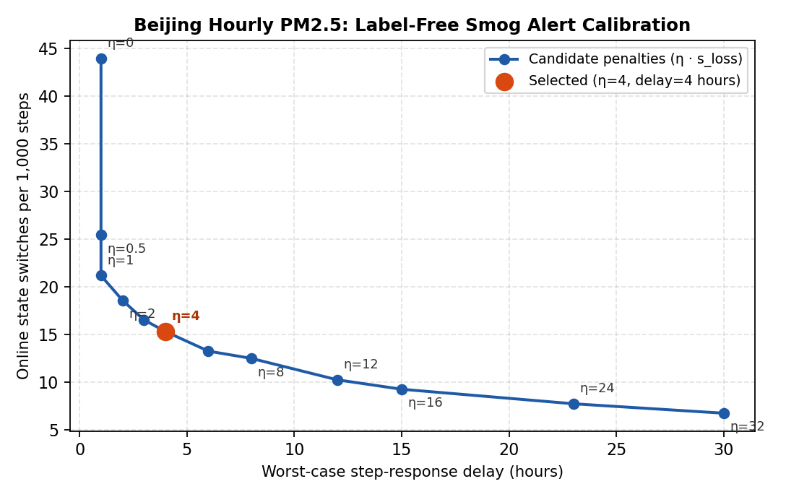
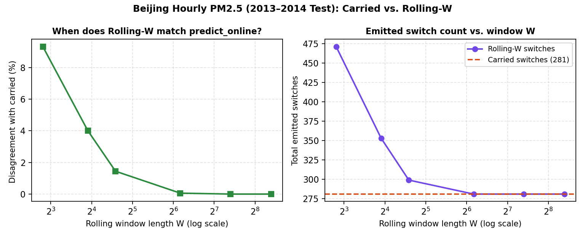

# `jm-online` — Streaming Inference & Label-Free Penalty Calibration for Statistical Jump Models

[](https://github.com/VincentTLe/jumpmodel-online/actions/workflows/ci.yml)
[](LICENSE)
[](pyproject.toml)

`jm-online` is a lightweight Python library (~450 lines of core source code, **requiring only `numpy`**) that addresses two practical gaps in real-time deployments of Statistical Jump Models and the [`Yizhan-Oliver-Shu/jump-models`](https://github.com/Yizhan-Oliver-Shu/jump-models) ecosystem:

1. **Step-by-Step Streaming Inference (`step(x_t)`) & Carried-vs-Rolling Diagnostics:**
   - In `jumpmodels`, `predict_online(X)` propagates forward dynamic-programming arrival costs indefinitely from $t = 0$ (`carried` mode), whereas empirical papers often re-solve a sliding window of $W$ observations from scratch and emit its final state (`rolling` mode).
   - `OnlineJumpDecoder` supports both modes in stateful step-by-step streaming ($O(K^2)$ time and $O(K)$ memory per step for `carried`), wraps fitted `JumpModel` and `SparseJumpModel` objects directly via `OnlineJumpDecoder.from_jumpmodel(model)`, and requires neither `matplotlib` nor `scikit-learn` for core inference.
2. **Label-Free `jump_penalty` ($\lambda$) Calibration via Detection-Delay Budgets:**
   - Instead of hardcoding `jump_penalty = 50.0` or tuning $\lambda$ on historical trading returns (which is inapplicable outside finance and prone to overfitting), `jm-online` normalizes $\lambda = \eta \cdot s_{\text{loss}}$ by the median training loss gap and computes exact **worst-case step-response delays** $d_{\max}(\lambda)$.
   - Operators specify a physical **delay budget** $B$ (e.g., $\le 5$ minutes for room HVAC control, $\le 4$ hours for urban smog advisories, or $\le 3$ trading days for market volatility risk alerts), and `select_penalty_by_delay_budget()` automatically selects the penalty within $\lambda < B\Delta$ that minimizes false switching churn—using **zero ground-truth regime labels**.

See **[`PROOFS.md`](PROOFS.md)** for a plain-English intuition and self-contained one-page proofs of all three underlying theorems, and **[`paper/paper.pdf`](paper/paper.pdf)** for the full manuscript.

---

## Repository Layout

```text
jumpmodel-online/
  pyproject.toml                 # Package metadata (core dependency: numpy>=1.24)
  PROOFS.md                      # Plain-English intuition & one-page mathematical proofs
  paper/
    paper.tex                    # LaTeX source of the companion paper
    paper.pdf                    # Compiled 8-page manuscript
  src/jm_online/
    decoder.py                   # Streaming/rolling/offline decoders & pure-NumPy JM fitter
    diagnostics.py               # Step-response delay bounds, delay-budget selector, Carried vs. Rolling-W
    plotting.py                  # Latency-Churn Pareto & Carried-vs-Rolling plots (lazy matplotlib import)
  examples/
    run_real_benchmarks.py       # Auto-downloads public UCI/FRED datasets and reproduces all benchmarks
  tests/
    test_jm_online.py            # Unit tests verifying exact parity with `jumpmodels` and theoretical bounds
  outputs/                       # Reproduced CSV/JSON tables and benchmark figures
```

---

## Installation

```bash
git clone https://github.com/VincentTLe/jumpmodel-online.git
cd jumpmodel-online
pip install -e .          # Core inference & diagnostics (numpy only)
pip install -e ".[dev]"   # Include pytest, pandas, and matplotlib for benchmarks/plots
```

---

## Quickstart

```python
from jm_online import (
    OnlineJumpDecoder,
    compare_carried_vs_rolling,
    evaluate_penalty_curve,
    fit_jump_model,
    select_penalty_by_delay_budget,
)

# 1. Fit centroids on training data (or wrap an existing `jumpmodels` estimator via `OnlineJumpDecoder.from_jumpmodel(jm)`)
fit = fit_jump_model(X_train, n_components=2, jump_penalty=2.0, random_state=42)

# 2. Select jump_penalty automatically under a worst-case step-response delay budget <= 4 steps (no labels needed)
curve = evaluate_penalty_curve(X_train, fit.centers_)
chosen = select_penalty_by_delay_budget(curve, max_delay_steps=4)

# 3. Stream live observations one at a time in O(K^2) time and O(K) memory
decoder = OnlineJumpDecoder(fit.centers_, jump_penalty=chosen.jump_penalty)
for x_t in X_live_stream:
    state_t = decoder.step(x_t, mode="carried")

# 4. Diagnose whether a rolling window of length W introduces reset-induced extra switches
rows = compare_carried_vs_rolling(X_live_stream, fit.centers_, chosen.jump_penalty, windows=[7, 15, 63, 168])
```

---

## Out-of-Sample Empirical Benchmarks

Reproduce all tests, tables, and figures in ~15 seconds (public datasets are downloaded automatically on first run):

```bash
pytest -v
python examples/run_real_benchmarks.py
```

### 1. Label-Free Delay-Budget Penalty Calibration (`carried` online decoding)

| Monitoring Benchmark | Train Rows | Out-of-Sample Test Rows | Delay Budget $B$ | Selected $\eta$ ($\lambda$) | $\lambda=0$ Switches | Selected Switches | Churn Reduction | Out-of-Sample Physical / Held-Out Audit |
|---|---:|---:|---|---:|---:|---:|---:|---|
| **Smart-Building HVAC Sensors** *(UCI Occupancy, 1-min)* | 8,143 | 12,417 | $\le 5$ min | `4.0` (`20.38`) | 54 *(6.26/day)* | **14** *(1.62/day)* | **−74.1%** | **83.92%** unsupervised accuracy vs. held-out camera ground truth; **1.0-min** median arrival lag. |
| **Urban Air-Quality Smog Alerts** *(UCI Beijing PM2.5, 1-hr)* | 26,275 | 17,520 | $\le 4$ hr | `4.0` (`11.14`) | 831 *(34.65/mo)* | **281** *(11.72/mo)* | **−66.2%** | Cleanly separates ventilated air (median **28 $\mu\text{g/m}^3$**) from smog episodes (median **112 $\mu\text{g/m}^3$**). |
| **Market Volatility Stress Monitor** *(FRED CBOE VIX, 1-day)* | 4,265 *(1990–2006)* | 5,038 *(2007–2026)* | $\le 3$ days | `3.0` (`4.65`) | 259 *(12.96/yr)* | **65** *(3.25/yr)* | **−74.9%** | Separates calm markets (median VIX **13.5**) from stress regimes (median VIX **19.1**) over 20 out-of-sample years. |



### 2. Carried-Score (`predict_online`) vs. Rolling-Window (`rolling-W`) Inference

Consistent with **Theorem 2** in [`PROOFS.md`](PROOFS.md):
- **Short windows ($W = 7$) inflate false switching:** Resetting the window score to zero at every step produces **+14 extra switches** on UCI Building Test 2 (`24` vs. `10`), **+190 extra switches** on Beijing PM2.5 (`471` vs. `281`), and **+46 extra switches** on CBOE VIX (`111` vs. `65`).
- **Exact coalescence at moderate windows:** Once $W$ exceeds the empirical barrier-hitting horizon ($W \ge 127$ min on Occupancy, $W \ge 168$ hr on PM2.5, and $W \ge 63$ days on VIX), disagreement between `rolling-W` and `carried` drops to **identically 0.00%**, confirming that $O(1)$-memory carried-score streaming achieves the same output without window-recomputation overhead or short-window instability.



---

## License

Released under the [MIT License](LICENSE).
